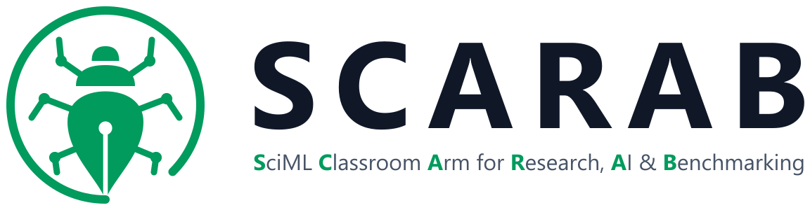

  <picture>
    <source media="(prefers-color-scheme: dark)" srcset="https://raw.githubusercontent.com/SCARAB-robot/docu/main/logo/png/scarab-logo-white-1152.png">
    
  </picture>

  <a href="https://github.com/SCARAB-robot/docu"><b>docu</b></a> ·
  <a href="https://github.com/SCARAB-robot/system">system</a> ·
  <a href="https://github.com/SCARAB-robot/model">model</a> ·
  <a href="https://github.com/SCARAB-robot/data">data</a>

**SCARAB** (**S**ciML **C**lassroom **A**rm for **R**esearch, **A**I & **B**enchmarking) is a Selective Compliance Assembly Robot Arm (SCARA) with two rotational axes that writes on a sheet of paper. A third axis lifts the pen and pushes it down onto the paper. SCARAB is used to generate benchmark data and as a training system for students to explore traditional and ML-based modeling and control.

# SCARAB · docu

**Project documentation of the SCARAB robot.**

## About this repository

This repository is the central documentation of the SCARAB project. It describes the robot, explains how the other repositories fit together and collects everything that is needed to build, simulate and use SCARAB.

It also holds the project's logos (`logo/`), as SVG and PNG, in a colored version for light backgrounds and a white version for dark backgrounds.

## Project structure

The SCARAB project is split into four repositories:

| Repository | Contents |
|---|---|
| **[docu](https://github.com/SCARAB-robot/docu)** (this repository) | **Project documentation** |
| [system](https://github.com/SCARAB-robot/system) | CAD files and PCB design files of the physical robot |
| [model](https://github.com/SCARAB-robot/model) | Simulation models of the robot |
| [data](https://github.com/SCARAB-robot/data) | Dataset recorded from the real robot |

In short: **system** contains files to manufacture the robot, **data** is recorded from it, **model** simulates it, and **docu** documents the project as a whole.

## License

This repository is licensed under the MIT License, see [LICENSE](LICENSE).
